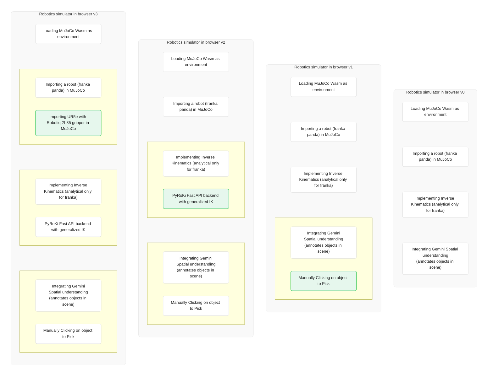

# Robotics Simulator in Browser (Franka Panda)

A web-based robotics simulator running directly in the browser using MuJoCo physics compiled to WebAssembly (WASM), Three.js rendering, and multimodal spatial reasoning via Gemini and manual direct targeting ("Click to Pick").

## Architecture Evolution



`Robotics simulator in browser v0` is taken from [Xavier Plantaz from Google AI](https://dev.to/googleai/building-a-gemini-powered-robotics-simulator-in-the-browser-with-mujoco-wasm-hjj) 

## Getting Started

### Prerequisites
- Node.js (v18+)
- npm or pnpm

### Installation & Run Locally
1. Install dependencies:
```sh
npm install
# or pnpm install
```
2. Set the `GEMINI_API_KEY` in [.env.local](.env.local) to your Gemini API key

3. Run Backend in another terminal (leave that running)
```sh
cd server
uv sync
uv run python pyroki_server.py
```

4. Run the app (in another terminal tab):
   `npm run dev`/ `pnpm run dev` at the root of project.

## Local MuJoCo DLS IK (experimental)

The `dls` solver runs in the browser and uses the loaded MuJoCo model as its
kinematic source of truth. It resolves the configured arm joints by name,
reads their `qpos`/actuator addresses from the compiled model, and evaluates
the TCP pose on a separate scratch `MjData`. The live simulation state is not
modified during optimization; only the resulting actuator controls are
written after a converged solution is found.

The first implementation uses a central finite-difference geometric Jacobian
and an adaptive damped-least-squares update. This is intentionally a portable
baseline while the `mj_jacSite` WASM export is verified. It is suitable for
interactive prototyping, but finite differences require multiple forward
passes per iteration and may be slower than a native MuJoCo Jacobian.

Select **DLS** in the IK solver panel to compare it with PyRoKi. PyRoKi remains
the default/reference solver. The local solver currently handles scalar hinge
and slide arm joints, joint limits, and 6D end-effector pose error. It does not
perform collision avoidance or trajectory planning.
